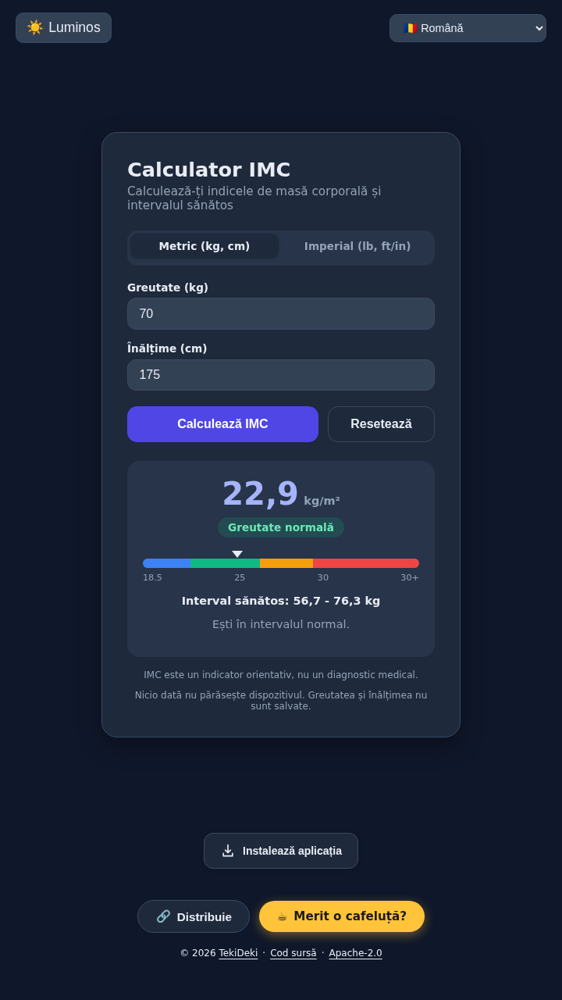
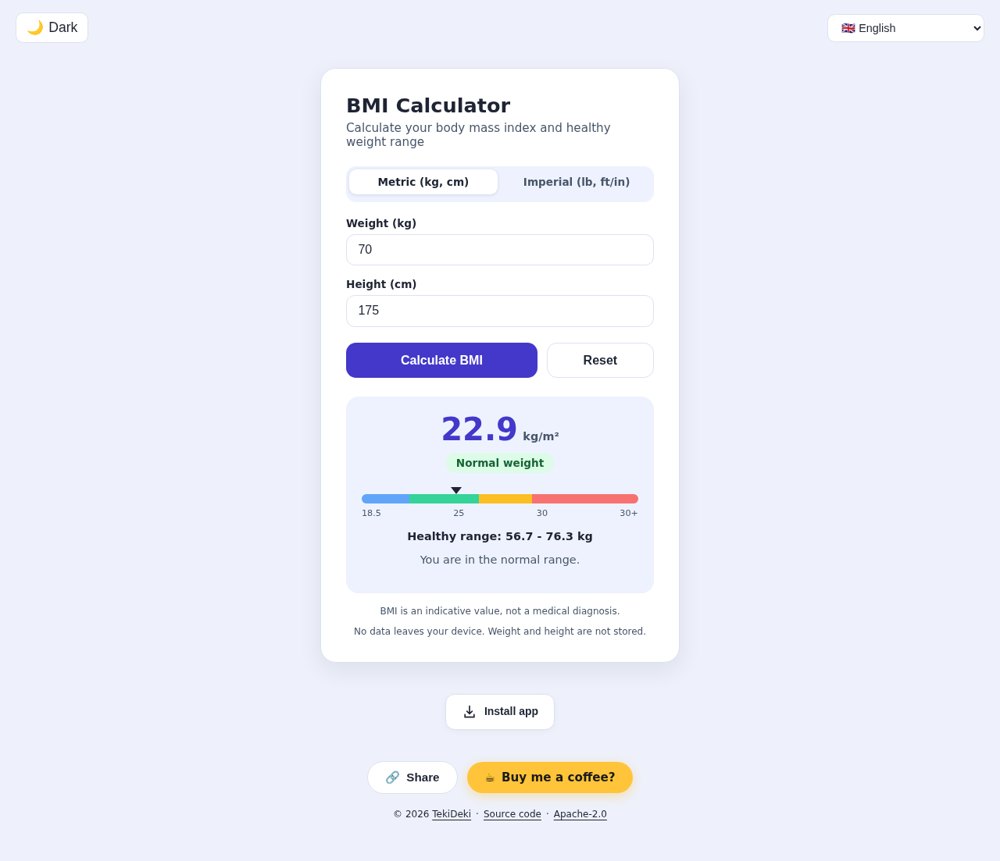

<div align="center">

# ⚖️ Calculator IMC / BMI Calculator

### Your Body Mass Index in two taps - in four languages

A zero-dependency, single-file web app that calculates your BMI, shows the healthy weight range for your height and tells you what it means.

[](LICENSE)
[](https://paypal.me/TekiDeki)
[](#-changelog)
[](#)
[](#)
[-purple?style=flat-square)](#-supported-languages)
[](#)

### 🚀 **[Try it live →](https://tekideki.github.io/BMI-Calculator/)**




</div>

---

## 🌐 Live Demo

**👉 [https://tekideki.github.io/BMI-Calculator/](https://tekideki.github.io/BMI-Calculator/)**

No installation needed. Works in any modern browser (Chrome, Firefox, Safari, Edge) - and offline once loaded.

---

## 📖 About

**Calculator IMC (BMI Calculator)** is a browser-based tool that calculates your **Body Mass Index** in seconds and puts the result in context: your category, the **healthy weight range for your height**, and how many kilograms or pounds separate you from it.

The app runs **100% client-side**. No build step, no backend, no tracking. Your data never leaves your browser - nothing is sent anywhere and nothing is stored about your body.

---

## ✨ Features

- ⚡ **Instant calculation** - Weight + Height → BMI value, category and a visual position on the BMI scale
- 🎯 **Healthy weight range** - the WHO normal range (BMI 18.5 - 24.9) computed for *your* height, e.g. `56.7 - 76.3 kg` for 175 cm
- 📉 **Distance to the range** - how much to gain or lose to reach the normal range (`-18.7 kg`, `+6.7 kg`)
- 📏 **Metric and imperial** - kg/cm or lb/ft-in, switchable at any time; what you typed is converted, and the value you entered first stays exact (no drifting BMI when you flip units)
- 🔢 **Local number formats** - `70,5` and `70.5` are both accepted; results follow the language (`22,9` in Romanian, `22.9` in English)
- ✅ **Field-level validation** - per-field messages announced to screen readers, sensible limits, and no silent `--`
- 🌗 **Dark & light theme** - applied before the first paint (no white flash), follows your system preference, remembers your choice
- 🌍 **4 languages** - Română, English, Srpski (latinica), Српски (ћирилица)
- 🔗 **Language and units in the URL** - shareable links such as `?lang=en`, `?lang=sr-Cyrl`, `?unit=imperial`
- 📤 **Share button** - native share sheet on mobile, clipboard copy fallback, then a copy prompt as a last resort
- 📦 **Works offline** - full PWA with service worker caching; installable on phone and desktop; prompts you to reload when a new version is cached
- ♿ **Accessible by default** - keyboard friendly, `aria-live` results, error messages tied to their fields, category shown as text (never colour alone), reduced-motion support
- 🪶 **Zero dependencies** - no frameworks, no build step, no CDN, no fonts to download
- 🔍 **SEO-ready** - JSON-LD (`WebApplication` with `featureList`), Open Graph and Twitter cards with a real 1200x630 image, canonical link and `hreflang` alternates
- 🔒 **Private by design** - weight and height are never saved; only theme, language and unit preference are remembered locally, with a safe fallback when storage is blocked
- ⚠️ **Honest by design** - a visible note reminds that BMI is an indicative value, not a medical diagnosis

---

## 📊 BMI Categories

| BMI | Category | EN |
|-----|----------|-----|
| < 18.5 | Subponderal | Underweight |
| 18.5 - 24.9 | Greutate normală | Normal weight |
| 25.0 - 29.9 | Supraponderal | Overweight |
| ≥ 30.0 | Obezitate | Obese |

The healthy range shown in the app is computed from the standard WHO thresholds:

- `min_kg = 18.5 x height_m²`
- `max_kg = 24.9 x height_m²`

> **Note:** BMI is a screening indicator, not a medical diagnosis. It does not distinguish muscle from fat mass, and the healthy range is a population reference, not a personal target. Always consult a healthcare professional for medical advice.

---

## 📏 Units

| System | Weight | Height |
|--------|--------|--------|
| Metric | kilograms (kg) | centimetres (cm) |
| Imperial | pounds (lb) | feet and inches (ft / in) |

Switching units converts the values already in the form:

- Weight is recalculated with the exact factors `1 lb = 0.45359237 kg` and `1 in = 2.54 cm`.
- Height converts to whole feet and inches (that is how heights are read), so `175 cm` becomes `5 ft 9 in` (175.26 cm).
- As long as you do not edit the fields, the app keeps the exact value you entered first, so pressing **Calculate** right after a unit switch returns the same BMI - no `22.9` turning into `22.8`.
- Your choice is remembered (and can be shared through `?unit=imperial`).

---

## ⌨️ Keyboard And Assistive Technology

| Action | How |
|--------|-----|
| Calculate | `Tab` to a field and press `Enter`, or activate the **Calculate** button |
| Reset | `Tab` to **Reset** and press `Enter` / `Space` |
| Switch unit system | `Tab` to the Metric / Imperial radio group, arrow keys |
| Change language / theme | Standard `select` and `button` controls |

- Results are announced through a polite live region (`role="status"`, `aria-atomic="true"`).
- Input errors use `aria-invalid` plus a message in a `role="alert"` element linked with `aria-describedby`.
- The category is always written out as text next to the colour; the colour scale is decorative (`aria-hidden`).
- Focus is always visible (`:focus-visible` ring), contrast was verified against WCAG 2.1 AA in both themes, and animations are disabled under `prefers-reduced-motion`.
- The page has `banner`, `main` and `contentinfo` landmarks and supports `color-scheme` so the browser UI matches the theme.

---

## 🚀 Quick Start

### Option 1 - Use the Live Demo (Simplest)

**👉 [https://tekideki.github.io/BMI-Calculator/](https://tekideki.github.io/BMI-Calculator/)**

Nothing to install. Just open and calculate.

### Option 2 - Clone & Run Locally

```bash
git clone https://github.com/TekiDeki/BMI-Calculator.git
cd BMI-Calculator

# Pick any static server
python -m http.server 8000
# or
npx serve
```

Then open **http://localhost:8000**

> ⚠️ **Note:** For PWA features (install prompt, offline mode) the app must be served over **HTTPS** or **localhost**.

### Option 3 - Fork & Deploy to Your Own GitHub Pages

1. **Fork** this repository
2. Go to **Settings → Pages**
3. Source: `Deploy from a branch` → Branch: `main` → Folder: `/ (root)`
4. Save → your app will be live at `https://YOUR-USERNAME.github.io/BMI-Calculator/`

---

## 📱 Install as an App (PWA)

### 🤖 Android (Chrome / Edge / Brave)

1. Open the [live demo](https://tekideki.github.io/BMI-Calculator/) in Chrome
2. Tap the **⋮ menu** → **"Install app"**
3. Confirm → the icon appears on your home screen

### 🍎 iPhone / iPad (Safari)

1. Open the [live demo](https://tekideki.github.io/BMI-Calculator/) in **Safari**
2. Tap the **Share button** → **"Add to Home Screen"**
3. Name it and tap **"Add"**

### 💻 Desktop (Chrome / Edge)

1. Open the live demo
2. Click the **install icon** (⊕) in the address bar
3. Click **"Install"** - the app opens in its own window

> Once installed, the app works offline thanks to the service worker (`sw.js`).

---

## 🌍 Supported Languages

| Code | Language | Default |
|------|----------|:-------:|
| `ro` | Română | ✅ (fallback) |
| `en` | English | - (auto-detected from browser) |
| `sr-Latn` | Srpski (latinica) | - |
| `sr-Cyrl` | Српски (ћирилица) | - |

The interface language follows this priority: **URL parameter** (`?lang=…`) → saved choice → browser language → Romanian.

---

## 🛠️ Tech Stack

- **HTML5** - one file, semantic markup, landmarks
- **CSS3** - custom properties for theming, no preprocessor
- **Vanilla JavaScript** - no frameworks, no bundler, no npm
- **Service Worker** - offline caching (cache-first strategy) with an update notice
- **Web App Manifest** - installable as a PWA, with screenshots and shortcuts
- **JSON-LD** - structured data for SEO (`WebApplication`)

No external CDNs. No analytics. No tracking.

---

## 📁 Project Structure

```
BMI-Calculator/
├── index.html              # Standalone app (HTML + CSS + JS)
├── manifest.json           # PWA manifest (name, icons, screenshots, shortcuts)
├── sw.js                   # Service worker (offline caching)
├── og-image.png            # Social preview image (1200x630)
├── screenshot-narrow.png   # App screenshot used by the manifest and this README
├── screenshot-wide.png     # Desktop screenshot used by the manifest and this README
├── icon.svg                # App icon (scalable)
├── icon-192.png            # PWA icon 192x192
├── icon-512.png            # PWA icon 512x512
├── icon-maskable-512.png   # PWA maskable icon
├── apple-touch-icon.png    # iOS home screen icon
├── favicon.ico             # Browser tab icon
├── LICENSE                 # Apache License 2.0
├── NOTICE                  # Attribution notice
└── README.md               # This file
```

---

## 📄 License

Distributed under the **Apache License 2.0**. See [LICENSE](LICENSE) and [NOTICE](NOTICE) for details.

---

## 🙏 Disclaimer

This tool provides an indicative BMI value based on the standard WHO formula. It is **not a medical device** and does not replace professional medical advice, diagnosis, or treatment.

---

## 📜 Changelog

### 2.0 - 2026-10-15

- **New:** healthy weight range for the entered height, plus the distance to it.
- **New:** visual BMI scale with a marker and a category chip (text, not colour alone).
- **New:** metric and imperial units with conversion in both directions.
- **New:** decimal comma accepted (`70,5`), results formatted per language.
- **New:** per-field validation with `aria-live` / `role="alert"` messages, limits on impossible values, `Enter` submits the form.
- **Fixed:** saved dark theme no longer flashes light on load (theme is applied before the first paint).
- **Fixed:** storage is accessed through a safe wrapper, so the app still works when `localStorage` is blocked (private mode, strict settings).
- **Fixed:** the "new version available" bar is hidden until the service worker actually reports an update.
- **Fixed:** the weight label no longer shows imperial units while the metric system is selected.
- **Improved:** results announced to screen readers, visible focus rings, WCAG AA contrast in both themes, reduced-motion support, no inline `onclick` handlers.
- **Improved:** social card is a real 1200x630 PNG with `summary_large_image`; JSON-LD gained `featureList`, `softwareVersion` and `isAccessibleForFree`.
- **Improved:** offline cache bumped to `calculator-imc-v6`, including the social image; install section and credits unchanged in behaviour.

### 1.x

- 1.0 - first public release: BMI value, category, four languages, dark/light theme, share button, PWA install and offline support.

---

<div align="center">

**Built with ❤️ and vanilla JavaScript**

[⬆ Back to Top](#%EF%B8%8F-calculator-imc--bmi-calculator)

</div>


## Install app

Use the **Install app** button near the footer. On supported browsers it opens the native installation prompt when available. Otherwise it shows localized instructions for Safari on iPhone/iPad, Android, and desktop browsers. Installation is controlled by the browser; no installation is claimed without its confirmation. The button is hidden in a standalone/minimal-ui app window and after an `appinstalled` event in the current session. A normal browser tab cannot always detect a previous installation.

Installation needs HTTPS or trustworthy localhost. The controls add no dependencies, tracking, network calls or storage keys; existing application data is not modified. On an existing cached version, revisit online and refresh after the service worker has updated to see the button. No automatic reload is forced.
